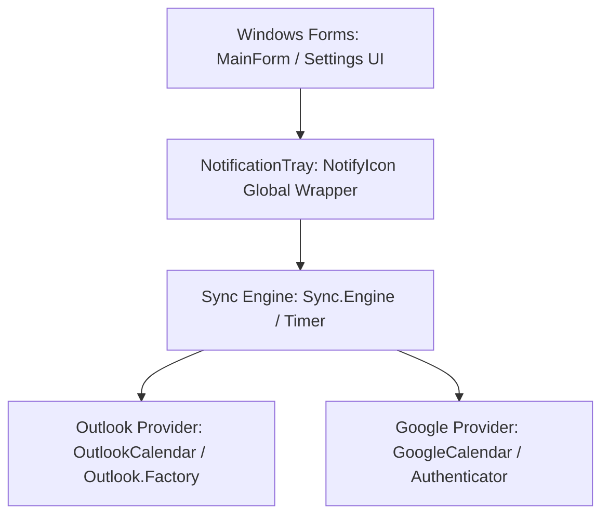
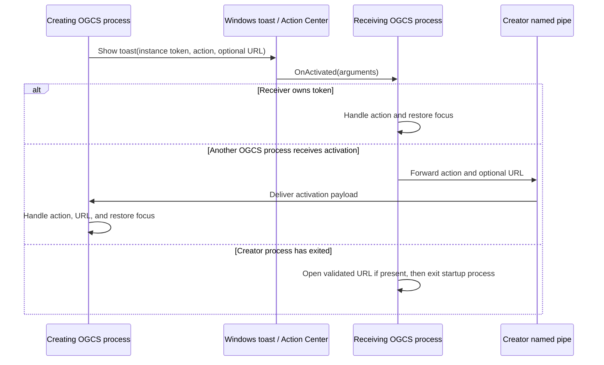
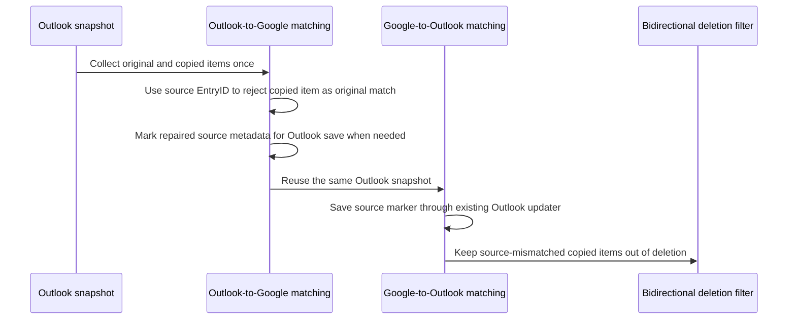

# Architecture Overview - Outlook Google Calendar Sync (OGCS)

Outlook Google Calendar Sync is a lightweight, background C# Windows Forms utility designed to sync calendar events bidirectionally or unidirectionally between Microsoft Outlook and Google Calendar.

## Core System Components

### 1. UI Layer (WinForms)
- **MainForm**: Provides the tabbed user interface for settings (sync options, outlook setup, google setup, calendar selection, and application options) and the sync log.
- **NotificationTray**: A single, global wrapper around the Windows `NotifyIcon` (System Tray Icon). Handles context menus, tooltips, and balloon notifications cleanly while avoiding leak issues common in multi-threaded UI/tray environments.

### 2. Sync Engine (`Sync/Engine.cs`)
- Orchestrates the synchronization process based on the configured sync direction (`OutlookToGoogle`, `GoogleToOutlook`, or `Bidirectional`).
- Manages sync timers, custom attributes mapping, date range calculation, and conflict resolution rules.
- Executes on background threads to prevent UI blockages.

### 3. Outlook Provider (`Outlook/` & `Outlook.Factory/`)
- Interacts with local Microsoft Outlook installations.
- Leverages Outlook Interop or Microsoft Graph APIs depending on the configuration.
- Abstracts recurrence parsing and customized category/color mappings.

### 4. Google Calendar Provider (`Google/` and `Google.Graph/`)
- Interfaces with the Google Calendar API (v3) using OAuth2 credentials.
- Handles authorization, token refresh, attendee registration, and meet links.
- Uses `Google.Apis.Calendar.v3` client libraries.

### 5. Windows Toast Notifications
- `NotificationTray` selects `ModernToastNotificationHandler` on Windows 10 and later, with the legacy `NotifyIcon` balloon handler used on older Windows versions.
- Modern notifications are created with `ToastNotificationManagerCompat`. Each toast includes the action to perform, an optional base64-encoded browser URL, and a random per-process instance token.
- A click on a live toast is handled by the process that owns the `ToastNotification` object. An Action Center click is delivered through `ToastNotificationManagerCompat.OnActivated`.
- Because multiple OGCS configurations can run at the same time, each process listens on a named pipe derived from its instance token. If Windows delivers an Action Center activation to another OGCS process, that process forwards the action to the token owner.
- The owner handles the action and optional browser URL through the same `NotificationTray.notificationClicked` callback used by legacy notifications, restoring the correct OGCS window, selecting the Sync tab where appropriate, or opening a validated HTTP(S) URL.
- A process launched by an Action Center activation is detected during startup, before the main form is created. It forwards the activation to a live owner when possible, ignores stale activations when the owner pipe is gone, and exits without leaving an additional OGCS instance running.
- The activation subscription is registered once per process. The token is regenerated on every process start, so notifications from a previous process lifetime cannot target a restarted instance.
- Each modern toast receives a unique tag containing the current process token. On graceful tray shutdown, the handler unsubscribes activation, cancels its pipe listener, and removes only its tracked toast tags from notification history; legacy balloon notifications are not involved.

### 6. Classic Outlook/Google Sync Snapshot and Copy Identity
- A Classic sync collects `outlookEntries` once before either direction runs. In bidirectional mode, Outlook-to-Google runs first and Google-to-Outlook reuses the same Outlook appointment snapshot; the second phase does not rescan Outlook. An item copied after collection is therefore invisible until the next sync.
- A pasted copy of an already-synchronized Outlook appointment can inherit OGCS Google event and calendar IDs while receiving a new Outlook `EntryID`. The durable `outlookEntryID` source marker is what distinguishes the copied item from the original.
- The bidirectional failure mode is a two-phase matching problem. If the copied item is allowed to consume the original Google event match, the original Outlook item remains unmatched. The later Outlook deletion list can then contain the original, while the copied item has been removed as an apparent match rather than being created as a new Google event.
- New Google event creation establishes the active calendar key set before writing its source marker. A suffix-aware fill then populates missing source markers for every existing calendar key set, without replacing populated markers or changing the active-keyset cache. The existing active-keyset write still refreshes the marker when a copy is linked to a newly created Google event.
- The one-time migration scans the selected Outlook folder and repairs missing markers across all valid key sets, including `-01`-only and noncontiguous suffixes. Its per-profile, calendar-pair state is versioned and persisted before each full scan. It makes at most three started attempts across restarts, marks only a clean full scan complete, and reports exhaustion instead of rescanning indefinitely. Clearing `SourceEntryIDBackfillProfile` for that profile in `settings.xml` is the documented manual retry.
- A missing marker on an already-copied item cannot recover its former EntryID; when repaired, the current EntryID is stored. Future copies can then inherit the marker and be detected. The fill helper never overwrites a populated marker, including one that differs from the current EntryID.
- Outlook-to-Google-only sync leaves previously untagged Outlook appointments without OGCS Google or source EntryID properties. Existing copied appointments that already carry OGCS metadata retain the established behavior of refreshing those IDs when a separate Google event is created. After switching the profile to bidirectional sync, the standard in-range O->G matcher can match existing Google events through their stored Outlook IDs. Only after a match succeeds does OGCS hydrate missing Google IDs and source markers on the Outlook appointment, then mark it for the ordinary G->O Outlook save path. This continues after the one-time backfill is complete; items outside the configured window are hydrated on a later sync.
- The correct invariant is that bidirectional copied-item protection must be established before matching, must use `Outlook.CustomProperty` on the Outlook `AppointmentItem`, and must be persisted through the Outlook save path. Source-mismatched items must be excluded from both reverse matching and bidirectional deletion. One-way Outlook-to-Google behavior is intentionally unchanged: a copied item that is not already represented in Google is allowed to sync as a new Google event.

## Data Consistency & Timezones
- **Timestamp Strategy**: The application prioritizes `DateTimeOffset` for all calendar event timestamps to ensure unambiguous point-in-time representation across different timezones.
- **Comparison Logic**: To avoid local clock-time bugs, comparisons between local `DateTime` variables and API-sourced `DateTimeOffset` values must explicitly specify whether they are comparing the clock face (`.DateTime`), the calendar date (`.Date`), or the universal instant (`.UtcDateTime`).
- **Sync Window Boundaries**: `SyncStart` and `SyncEnd` represent local midnight boundaries for classic Outlook and recurrence queries. Cloud range filters use the corresponding UTC instants, while Graph recurrence queries use local midnight with the system offset in ISO 8601 format.
- **Standardized Extensions**: Custom extension methods (e.g., `SafeDateTimeOffset()`) are used to normalize date parsing from various API formats into a consistent internal representation.
