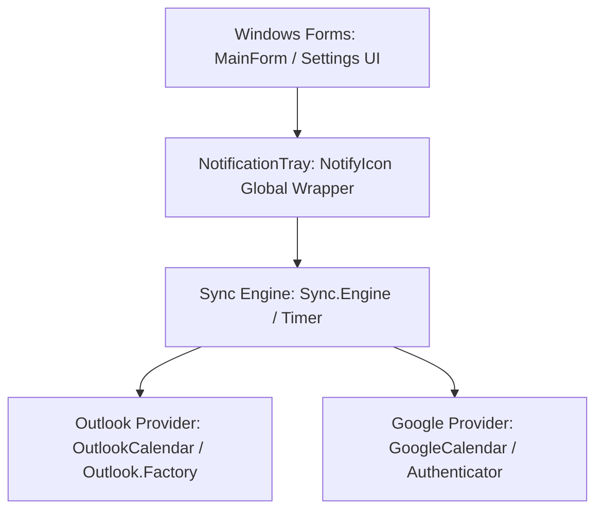
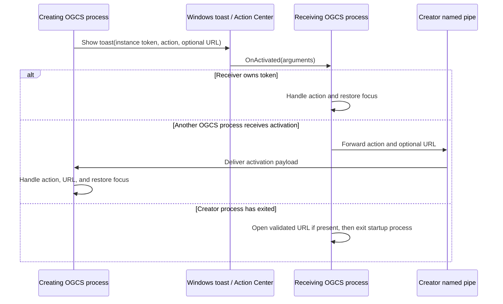

# Architecture Overview - Outlook Google Calendar Sync (OGCS)

Outlook Google Calendar Sync is a lightweight, background C# Windows Forms utility designed to sync calendar events bidirectionally or unidirectionally between Microsoft Outlook and Google Calendar.

## Core System Components

### 1. UI Layer (WinForms)
- **MainForm**: Provides the tabbed user interface for settings (sync options, outlook setup, google setup, calendar selection, and application options) and the sync log.
- **NotificationTray**: A single, global wrapper around the Windows `NotifyIcon` (System Tray Icon). Handles context menus, tooltips, and balloon notifications cleanly while avoiding leak issues common in multi-threaded UI/tray environments.

### 2. Sync Engine (`Sync/Engine.cs`)
- Orchestrates the synchronization process based on the configured sync direction (`OutlookToGoogle`, `GoogleToOutlook`, or `Bidirectional`).
- Manages sync timers, custom attributes mapping, date range calculation, and conflict resolution rules.
- Executes on background threads to prevent UI blockages.

### 3. Outlook Provider (`Outlook/` & `Outlook.Factory/`)
- Interacts with local Microsoft Outlook installations.
- Leverages Outlook Interop or Microsoft Graph APIs depending on the configuration.
- Abstracts recurrence parsing and customized category/color mappings.

### 4. Google Calendar Provider (`Google/` and `Google.Graph/`)
- Interfaces with the Google Calendar API (v3) using OAuth2 credentials.
- Handles authorization, token refresh, attendee registration, and meet links.
- Uses `Google.Apis.Calendar.v3` client libraries.

### 5. Windows Toast Notifications
- `NotificationTray` selects `ModernToastNotificationHandler` on Windows 10 and later, with the legacy `NotifyIcon` balloon handler used on older Windows versions.
- Modern notifications are created with `ToastNotificationManagerCompat`. Each toast includes the action to perform, an optional base64-encoded browser URL, and a random per-process instance token.
- A click on a live toast is handled by the process that owns the `ToastNotification` object. An Action Center click is delivered through `ToastNotificationManagerCompat.OnActivated`.
- Because multiple OGCS configurations can run at the same time, each process listens on a named pipe derived from its instance token. If Windows delivers an Action Center activation to another OGCS process, that process forwards the action to the token owner.
- The owner handles the action and optional browser URL through the same `NotificationTray.notificationClicked` callback used by legacy notifications, restoring the correct OGCS window, selecting the Sync tab where appropriate, or opening a validated HTTP(S) URL.
- A process launched by an Action Center activation is detected during startup, before the main form is created. It forwards the activation to a live owner when possible, ignores stale activations when the owner pipe is gone, and exits without leaving an additional OGCS instance running.
- The activation subscription is registered once per process. The token is regenerated on every process start, so notifications from a previous process lifetime cannot target a restarted instance.
- Each modern toast receives a unique tag containing the current process token. On graceful tray shutdown, the handler unsubscribes activation, cancels its pipe listener, and removes only its tracked toast tags from notification history; legacy balloon notifications are not involved.

## Data Consistency & Timezones
- **Timestamp Strategy**: The application prioritizes `DateTimeOffset` for all calendar event timestamps to ensure unambiguous point-in-time representation across different timezones.
- **Comparison Logic**: To avoid local clock-time bugs, comparisons between local `DateTime` variables and API-sourced `DateTimeOffset` values must explicitly specify whether they are comparing the clock face (`.DateTime`), the calendar date (`.Date`), or the universal instant (`.UtcDateTime`).
- **Sync Window Boundaries**: `SyncStart` and `SyncEnd` represent local midnight boundaries for classic Outlook and recurrence queries. Cloud range filters use the corresponding UTC instants, while Graph recurrence queries use local midnight with the system offset in ISO 8601 format.
- **Standardized Extensions**: Custom extension methods (e.g., `SafeDateTimeOffset()`) are used to normalize date parsing from various API formats into a consistent internal representation.
- **Windows/IANA Timezone Data**: Windows timezone IDs and rules, IANA tzdb zone rules, and CLDR's Windows-to-IANA mappings are distinct data that may be updated at different times. A new zone appearing in Windows does not guarantee OGCS can map it to an IANA zone. See the [timezone knowledge note](knowledge/timezones/issue-2377.md) for OGCS's NodaTime data path and investigation guidance.
